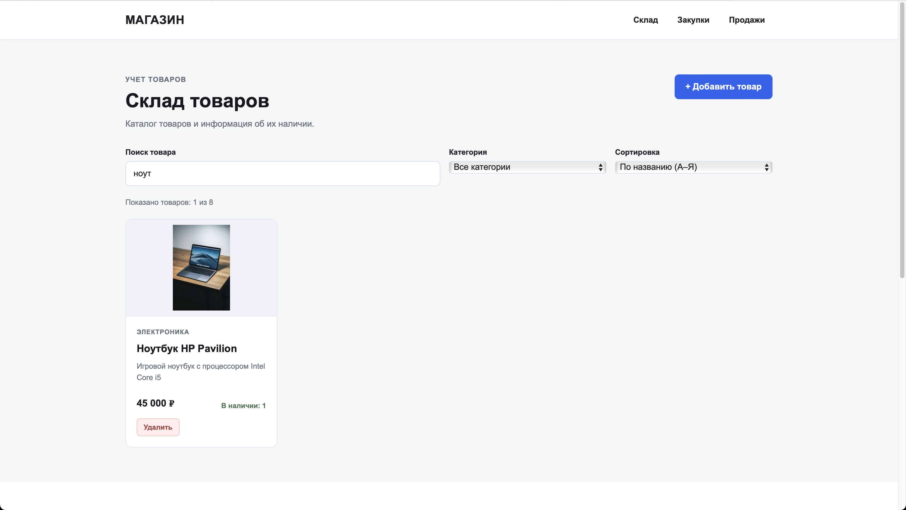
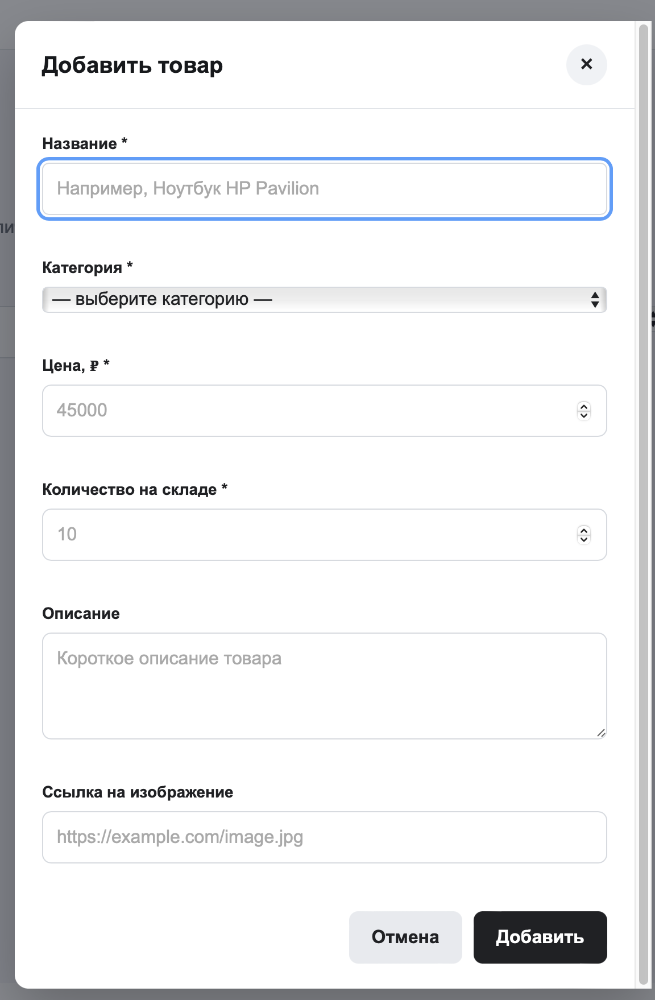

# Система учета товаров магазина

## О проекте

Афтахов Динар Ильгизович ИВТ-ИСУ-302Б

Была создана страница для учета товаров в магазине электроники. Вторая лабораторная работа превратила статичный макет в интерактивное приложение с возможностью добавления, поиска, фильтрации и удаления товаров.

## Цель работы

Превратить статический HTML/CSS-макет в динамическое веб-приложение (SPA). Научиться работать с DOM-деревом, обрабатывать события, делать валидацию форм, управлять состоянием приложения и сохранять данные в браузере.

## Блоки страницы

- Хедер с навигацией;
- «Склад» с карточками товаров и панелью управления (поиск, фильтр, сортировка);
- Модальное окно для добавления нового товара;
- «Закупки»;
- «Продажи»;
- Футер.

## Как открыть

Скачать проект и открыть файл `index.html` в браузере. Работает без локального сервера.

## Реализация

В проекте используются HTML, CSS и JavaScript (Vanilla JS, без сторонних библиотек).

**HTML и CSS** отвечают за структуру и оформление страницы.

**JavaScript** (файл `js/app.js`) реализует всю интерактивность:

1. **State-Driven UI.** Все данные хранятся в едином объекте `state` (массив товаров, строка поиска, выбранная категория, режим сортировки). Любое действие пользователя сначала меняет `state`, а затем вызывается функция `render()`, которая заново отрисовывает карточки по актуальному состоянию.
2. **Динамический поиск.** Ищет по названию и описанию в реальном времени (событие `input`), регистр не важен.
3. **Фильтрация и сортировка.** Выпадающие списки позволяют фильтровать по категории и сортировать по названию или цене. Сортировка иммутабельная (исходный массив не меняется).
4. **Модальное окно.** Добавление новых товаров через форму. Окно закрывается по крестику, кнопке «Отмена», клику по фону или клавише Escape.
5. **Валидация формы.** Используется Constraint Validation API (`required`, `minlength`, `min`, `max`, `type`). При ошибках под полями выводятся понятные сообщения, страница не перезагружается.
6. **Делегирование событий.** Удаление товаров работает через один обработчик на общем контейнере. Используется `e.target.closest()` для поиска кнопки и карточки.
7. **localStorage.** Все изменения (добавление, удаление) сохраняются в браузере через `JSON.stringify`. При перезагрузке данные считываются обратно через `JSON.parse`.

Для изображений реализована защита: если картинка не загрузилась или не указана, подставляется SVG-заглушка «Нет изображения».

## Структура

```text
web-project/
├── index.html
├── css/
│   └── main.css
├── js/
│   └── app.js
├── assets/
│   └── images/
│       ├── laptop.jpg
│       ├── mouse.jpg
│       ├── keyboard.jpg
│       ├── monitor.jpg
│       ├── webcam.jpg
│       ├── headphones.jpg
│       ├── hdd.jpg
│       └── ram.jpg
└── README.md
└── README2.md

## Скриншот главной страницы



## Скриншот модального окна


