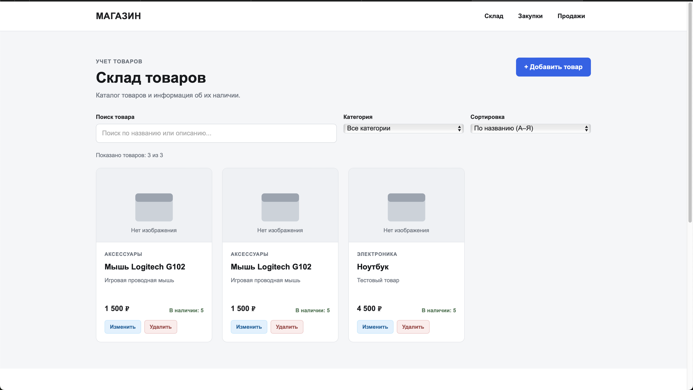
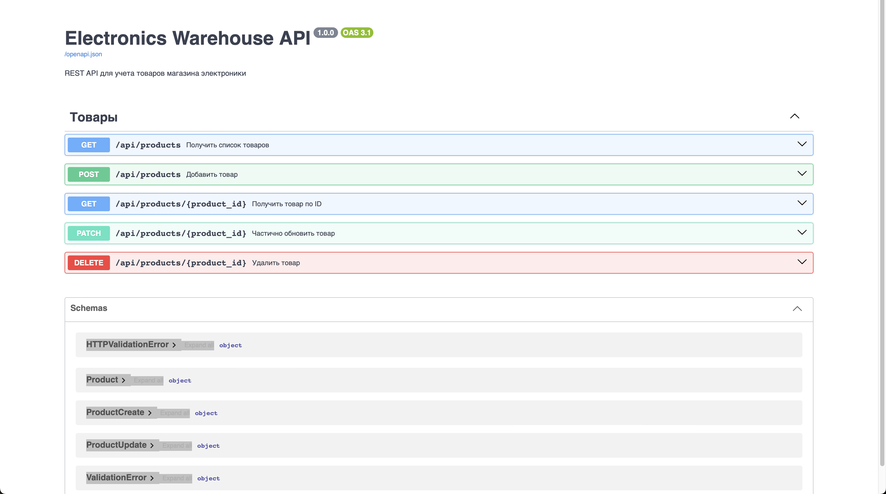
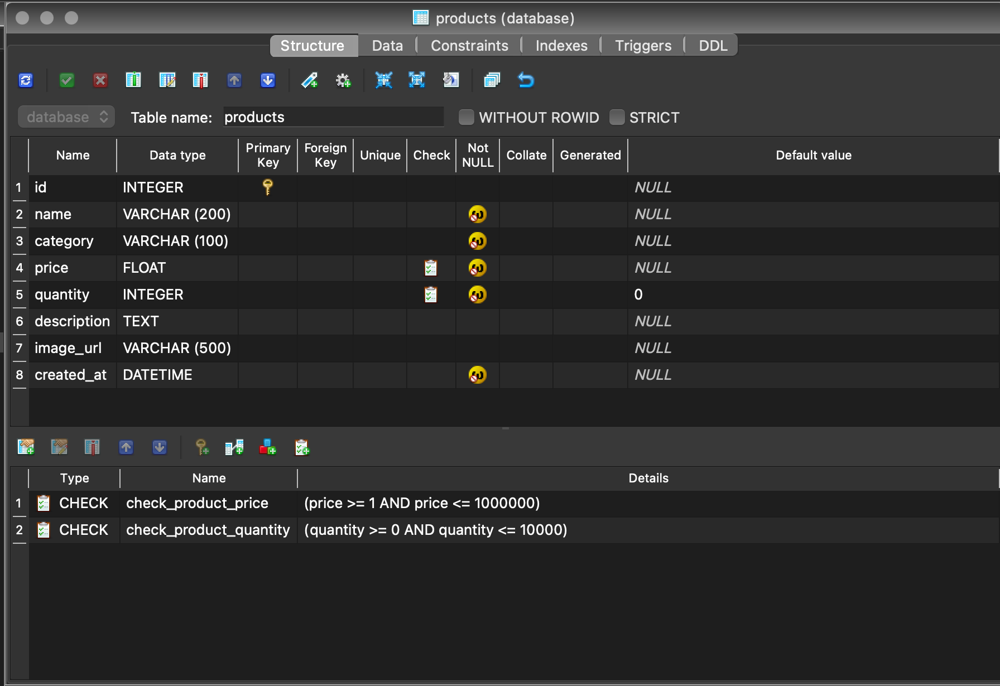

# Система учета товаров магазина

## О проекте

Афтахов Динар Ильгизович ИВТ-ИСУ-302Б

В третьей лабораторной работе к сайту учета товаров магазина электроники была добавлена серверная часть (backend) с REST API и базой данных. Теперь товары загружаются с сервера, а добавление, изменение и удаление выполняются через HTTP-запросы. Данные сохраняются в SQLite и не пропадают после перезапуска приложения.

## Цель работы

Научиться создавать backend на Python, проектировать REST API, выполнять CRUD-операции, хранить данные в реляционной базе данных и связывать frontend с backend через HTTP-запросы. Ознакомиться с автоматической документацией OpenAPI (Swagger UI).

## Блоки страницы

- Хедер с навигацией;
- «Склад» с карточками товаров, поиском, фильтрацией и сортировкой;
- Модальное окно добавления и редактирования товара;
- Кнопки изменения и удаления товаров;
- Информационные разделы «Закупки» и «Продажи»;
- Футер.

## Используемые технологии

- **Frontend:** HTML, CSS, JavaScript;
- **Backend:** Python, FastAPI;
- **База данных:** SQLite;
- **Работа с базой данных:** SQLAlchemy;
- **Валидация данных:** Pydantic;
- **Документация API:** Swagger UI / OpenAPI.

## Реализация

Основная сущность проекта — **товар (`Product`)**. Для каждого товара хранятся: `id`, `name`, `category`, `price`, `quantity`, `description`, `image_url`, `created_at`.

Backend разделен на несколько частей:

1. **`main.py`** — создает приложение FastAPI, подключает маршруты и настраивает CORS для запросов с frontend.
2. **`database.py`** — настраивает подключение к SQLite и работу с сессиями базы данных.
3. **`models.py`** — описывает таблицу `products`, типы данных и ограничения полей.
4. **`schemas.py`** — описывает Pydantic-схемы для создания, обновления и получения товаров; проверяет входящие данные.
5. **`crud.py`** — содержит функции добавления, чтения, изменения и удаления товаров через SQLAlchemy.
6. **`routers/products.py`** — обрабатывает HTTP-запросы и возвращает JSON-ответы с соответствующими статусами.

На frontend файл **`js/app.js`** отправляет запросы с помощью `fetch()`. После загрузки или изменения данных карточки товаров обновляются через функцию `render()`. Поиск, фильтрация и сортировка выполняются на стороне браузера.

**Принцип работы:** браузер отправляет запрос → FastAPI принимает его и проверяет данные → SQLAlchemy обращается к SQLite → сервер возвращает JSON → JavaScript обновляет страницу.

## REST API

| Метод | Адрес | Назначение |
|---|---|---|
| `GET` | `/api/products` | Получить список товаров |
| `POST` | `/api/products` | Добавить товар |
| `GET` | `/api/products/{product_id}` | Получить товар по ID |
| `PATCH` | `/api/products/{product_id}` | Изменить данные товара |
| `DELETE` | `/api/products/{product_id}` | Удалить товар |

При успешной работе API используются статусы `200 OK`, `201 Created`, `204 No Content`. Если товар не найден, сервер возвращает `404 Not Found`, а при ошибке валидации — `422 Unprocessable Content`.

**Пример JSON для добавления товара (`POST /api/products`):**

```json
{
  "name": "Мышь Logitech G102",
  "category": "Аксессуары",
  "price": 1500,
  "quantity": 5,
  "description": "Игровая проводная мышь",
  "image_url": null
}
```

## Как запустить

Для работы проекта нужен Python и установленные зависимости из `requirements.txt`.

**1. Запуск backend** (терминал в папке `backend`):

```bash
python3 -m venv .venv
source .venv/bin/activate
python -m pip install -r requirements.txt
python -m uvicorn app.main:app --reload
```

Создание виртуального окружения и установка зависимостей требуются только при первоначальной настройке. Таблица базы данных создается автоматически, если ее еще нет. Для обновления структуры ранее созданной базы используется `migrate_db.py` (при наличии в проекте, выполняется отдельно и однократно).

**2. Запуск frontend** (в другом терминале, из папки `frontend`):

```bash
python3 -m http.server 5500
```

**Адреса:**

- Сайт: http://127.0.0.1:5500
- Backend API: http://127.0.0.1:8000/api/products
- Swagger UI: http://127.0.0.1:8000/docs
- OpenAPI JSON: http://127.0.0.1:8000/openapi.json

## Структура

```text
web-project/
├── backend/
│   ├── app/
│   │   ├── __init__.py
│   │   ├── main.py
│   │   ├── database.py
│   │   ├── models.py
│   │   ├── schemas.py
│   │   ├── crud.py
│   │   └── routers/
│   │       ├── __init__.py
│   │       └── products.py
│   ├── database.db
│   ├── requirements.txt
│   └── migrate_db.py
├── frontend/
│   ├── index.html
│   ├── css/
│   │   └── main.css
│   ├── js/
│   │   └── app.js
│   └── assets/
│       └── images/
├── screenshots/
│   ├── main-page3.png
│   ├── swagger.png
│   └── database.png
├── README.md
├── README2.md
└── README3.md
```

## Скриншот главной страницы



## Скриншот Swagger UI



## Скриншот базы данных



## Вывод

В результате лабораторной работы сайт был преобразован в клиент-серверное приложение. Реализованы REST API для CRUD-операций, сохранение товаров в SQLite, проверка данных через Pydantic и автоматическая документация Swagger UI. Frontend получает и изменяет данные через запросы к backend.
