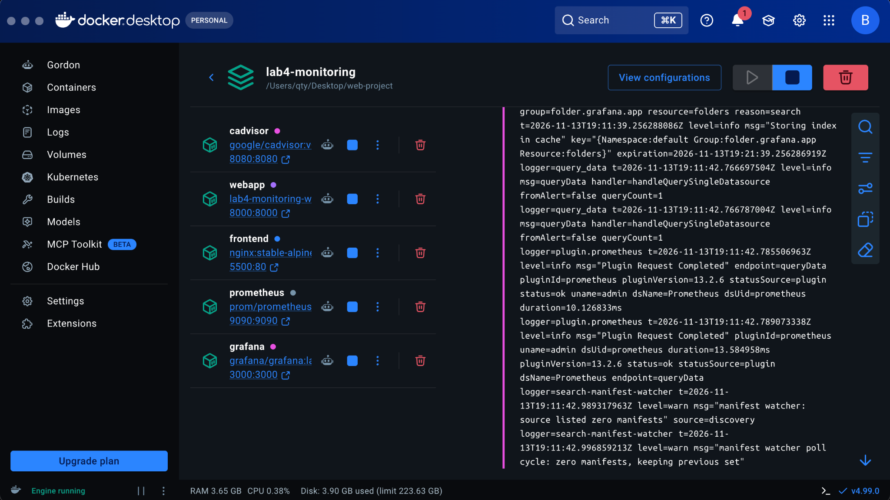
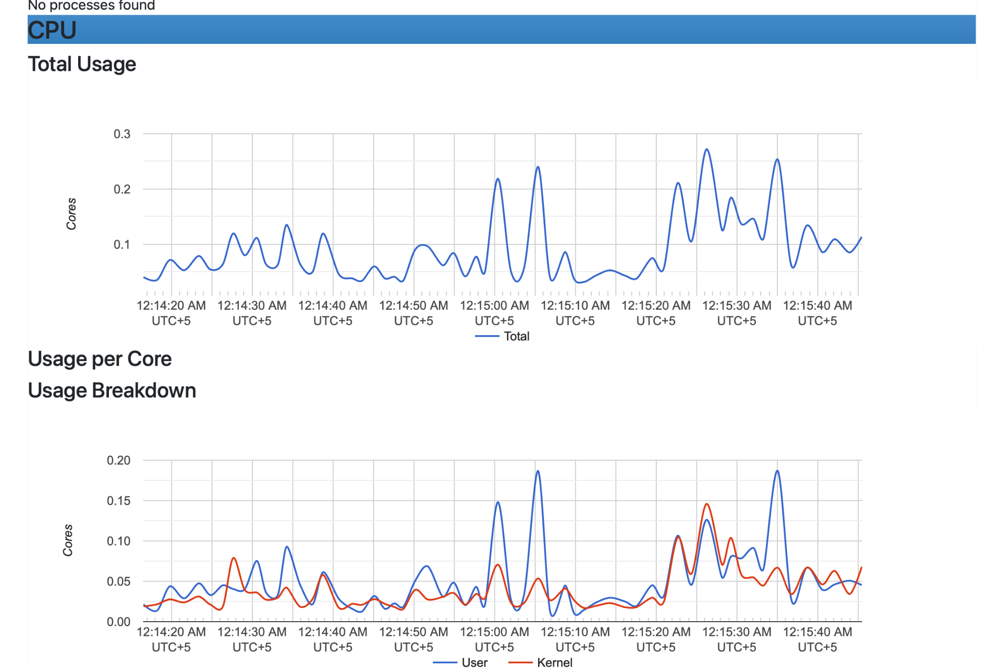
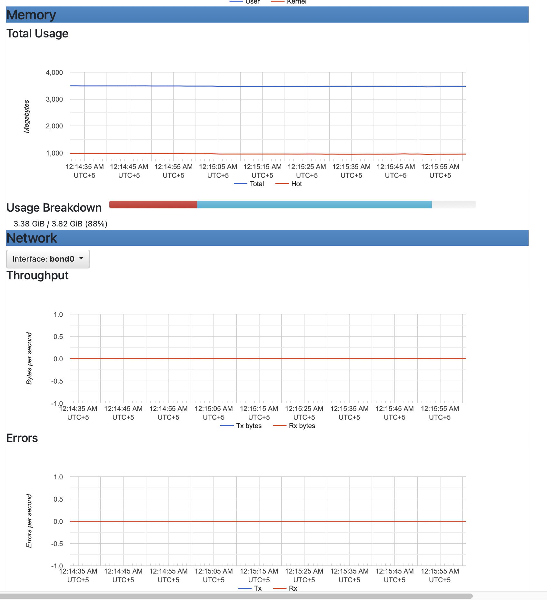
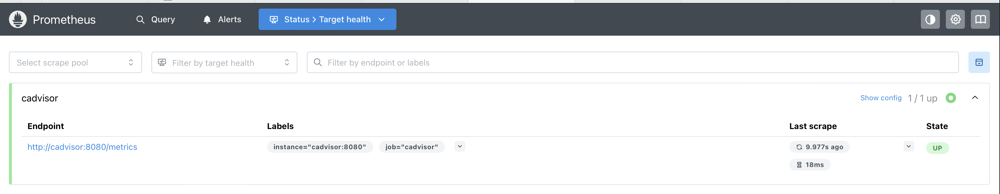
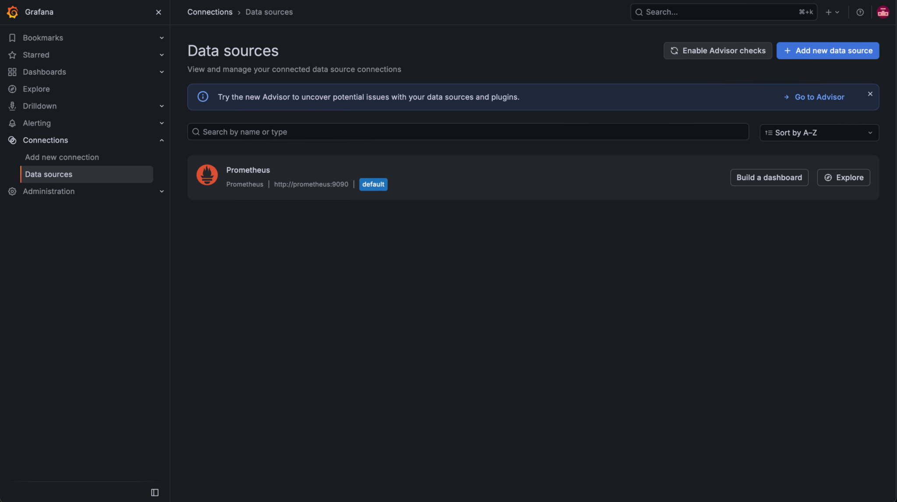
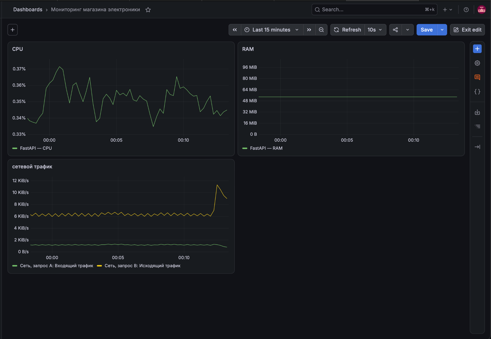
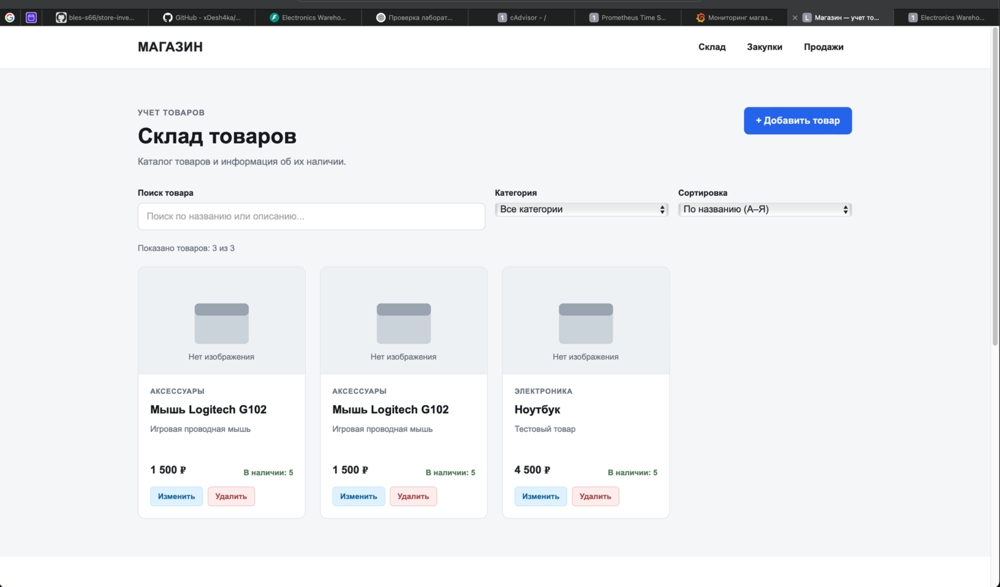

# Система учета товаров магазина

## О проекте

Афтахов Динар Ильгизович ИВТ-ИСУ-302Б

В четвертой лабораторной работе веб-приложение для учета товаров магазина электроники было запущено в Docker. Для наблюдения за использованием ресурсов настроен мониторинг с помощью cAdvisor, Prometheus и Grafana.

## Цель работы

Научиться запускать веб-приложение в Docker-контейнерах, настраивать сбор метрик, проверять доступность источников мониторинга и создавать дашборд с графиками CPU, оперативной памяти и сетевого трафика.

## Используемые технологии

- **Docker и Docker Compose** — запуск и управление контейнерами;
- **FastAPI и SQLite** — backend и база данных приложения;
- **cAdvisor** — сбор метрик использования ресурсов;
- **Prometheus** — периодический сбор и хранение метрик;
- **Grafana** — визуализация метрик на дашборде.

## Реализация

В файле `docker-compose.yml` описаны пять сервисов: `webapp`, `frontend`, `cadvisor`, `prometheus`, `grafana`. Все они подключены к одной Docker-сети `monitoring`.

1. **`webapp`** — контейнер с FastAPI-приложением. Его Docker-образ собирается по файлу `backend/Dockerfile`. База SQLite подключена из папки проекта.
2. **`frontend`** — контейнер nginx, который отображает сайт магазина электроники.
3. **`cadvisor`** — собирает доступные метрики контейнеров и предоставляет их для Prometheus.
4. **`prometheus`** — считывает метрики cAdvisor с адреса `cadvisor:8080` каждые 15 секунд, согласно файлу `monitoring/prometheus.yml`.
5. **`grafana`** — подключается к Prometheus по адресу `http://prometheus:9090` и отображает метрики на дашборде.

Схема работы: **Docker-контейнеры → cAdvisor → Prometheus → Grafana**.

В Prometheus проверен источник `cadvisor` со статусом **UP**. В Grafana настроен источник данных Prometheus и создан дашборд «Мониторинг магазина электроники» с тремя панелями:

- **CPU** — использование процессора контейнером FastAPI;
- **RAM** — использование оперативной памяти контейнером FastAPI;
- **Сетевой трафик Docker** — входящий и исходящий трафик интерфейса `eth0` Docker-окружения.

В ходе наблюдения загрузка CPU приложения была небольшой (примерно 0,33–0,37% одного логического ядра), а использование RAM оставалось около 53 MiB. На сетевом графике видны изменения скорости передачи данных. Искусственная нагрузка не создавалась.

## Как запустить

Необходимо установить и запустить Docker Desktop. В терминале, находясь в корне проекта, выполнить:

```bash
docker compose up -d --build
docker compose ps
```

Для остановки контейнеров:

```bash
docker compose down
```

**Адреса веб-интерфейсов:**

| Сервис | Адрес |
|---|---|
| Сайт магазина | http://127.0.0.1:5500 |
| FastAPI / Swagger | http://127.0.0.1:8000/docs |
| cAdvisor | http://127.0.0.1:8080 |
| Prometheus / Targets | http://127.0.0.1:9090/targets |
| Grafana | http://127.0.0.1:3000 |

## Структура

```text
web-project/
├── backend/
│   ├── app/
│   ├── Dockerfile
│   ├── .dockerignore
│   ├── database.db
│   └── requirements.txt
├── frontend/
│   ├── index.html
│   ├── css/
│   └── js/
├── monitoring/
│   ├── prometheus.yml
│   └── grafana/
│       └── datasources/
│           └── prometheus.yml
├── screenshots/
│   ├── docker-containers.png
│   ├── cadvisor-cpu.png
│   ├── cadvisor-memory-network.png
│   ├── prometheus-targets.png
│   ├── grafana-datasource.png
│   ├── grafana-dashboard.png
│   └── frontend-docker.png
├── docker-compose.yml
├── README.md
├── README2.md
├── README3.md
└── README4.md
```

## Скриншоты

### Запущенные Docker-контейнеры



### Мониторинг в cAdvisor





### Prometheus — Targets



### Подключение Grafana к Prometheus



### Дашборд Grafana



### Работающий сайт магазина



## Вывод

В результате лабораторной работы приложение было развернуто в Docker с помощью Docker Compose. Настроена система мониторинга: cAdvisor предоставляет метрики, Prometheus собирает и хранит их, а Grafana отображает графики. Проверены работа контейнеров, доступность источника метрик и визуализация показателей CPU, памяти и сетевого трафика.
